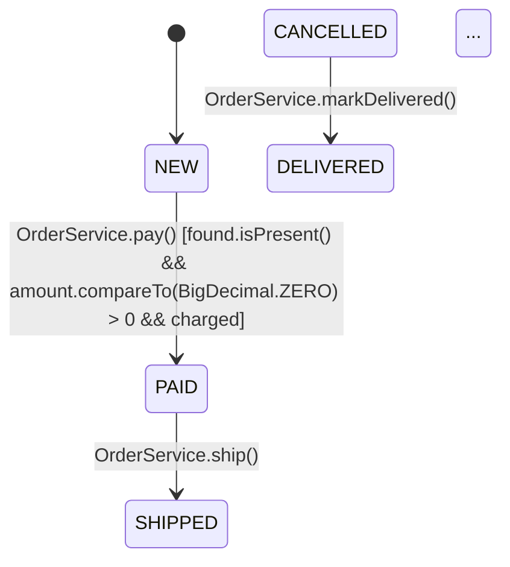

# truth-seeker

[](https://github.com/harrjdk/truth-seeker/actions/workflows/ci.yml)
[](LICENSE)

An MCP server that lets an LLM client (Claude Code, Claude Desktop, Codex, or a local model with MCP support)
**analyze compiled Java applications** — especially legacy Spring, Jakarta EE / Java EE and J2EE apps — and produce
**truth tables, state machine diagrams, call graphs and unit tests** straight from bytecode.

- Works on `.jar`, `.war`, `.ear`, Spring Boot fat jars and `target/classes` directories, including nested jars.
- **Never loads or runs the target application.** Classes are parsed with ASM; static initializers don't execute.
- No source code needed. Debug info (`-g`) improves names but isn't required.
- The server runs on **Java 17+**. It reads bytecode from Java 1.1 through 25, including javac and Eclipse (ECJ) output.

## Tools

| Tool | What it gives the model |
|---|---|
| `scan_archive` | Inventory: bytecode levels, bundled libraries, XML descriptors, stereotypes (Spring, EJB 2.x/3.x, Struts 1/2, servlets, JPA, MDBs, Quartz, Spring Batch…) and complexity hot spots |
| `list_endpoints` | HTTP routes (Spring MVC, JAX-RS, `@WebServlet`, **web.xml**, **struts-config.xml**), JMS/Kafka/Rabbit listeners, MDBs, `@Scheduled`, EJB timers, SOAP |
| `describe_class` | Kind, annotations, injected collaborators (field / constructor / setter (XML-wired) injection), fields, methods with cyclomatic complexity |
| `disassemble` | Raw bytecode for a class or one method, as ground truth |
| `call_graph` | Callers/callees as a Mermaid flowchart. Interface calls are expanded to the implementations in the archive |
| `truth_table` | A method's decisions and the **simplified boolean logic per outcome**. The summary (default) gives one row per outcome, with path counts and side effects listed once. `detail: "full"` gives one row per path, and `expand` adds the 2ⁿ table |
| `state_machine` | Mermaid / PlantUML state diagrams inferred from enum state. Also reports **derived state** (a status computed from other facts, e.g. from the last event). Flags unguarded transitions, never-entered or never-produced states, and state-guard rejections |
| `generate_unit_tests` | JUnit 5 + Mockito test classes (one class or `classNames`): one test per path, with solved inputs, stubs, assertions and `verify()` calls. Tests whose preconditions can't be arranged are `@Disabled` with exact `TODO`s. With `outputDir`, it writes the files and returns only a compact summary |
| `verify_tests` | Compiles test sources against the archive and runs them on JUnit 5 in a **separate JVM**. Reports passed / failed / disabled, with failures grouped by cause and disabled tests grouped by unresolved precondition. With `mutate: true` it also runs **mutation testing** (below). JUnit and Mockito are bundled, so it works offline. **Runs the application's code** |

All tools take `path`. The archive index is cached per path, so follow-up calls are fast.

Outputs are sized for an LLM's context: Markdown summaries by default, with full detail on request.
`format: "json"` (`truth_table`, `state_machine`), `generate_unit_tests` and `verify_tests` also return MCP `structuredContent`.
All tools except `generate_unit_tests` (writes files) and `verify_tests` (runs code) are annotated read-only, so clients can auto-approve them.

### The generate → verify loop

```text
generate_unit_tests  path=app.war  classNames=[...]  outputDir=build/gen-tests
verify_tests         path=app.war  testDir=build/gen-tests
```

`verify_tests` derives the classpath from the archive: Spring Boot `BOOT-INF/classes` + `BOOT-INF/lib`, WAR `WEB-INF/classes` + `WEB-INF/lib`, or EAR modules.
Files that don't compile are reported, and the rest still run.
`provided` container APIs (`javax.servlet`, `jakarta.persistence`, ...) are never inside a WAR. When the generated tests need one (a missing package, or a supertype such as `javax.batch.api.chunk.ItemProcessor` that cannot be accessed), `verify_tests` takes a jar that really holds that package from the local Maven repository (`~/.m2`, the specific API or the `javaee-api`/`jakartaee-api` umbrella) and says so; otherwise pass it with `extraClasspath`.
It needs a JDK, not a JRE, and extracts to `java.io.tmpdir/truth-seeker` (override with `-Dtruthseeker.cache=…`).

### Do the tests catch changes? (mutation testing)

```text
verify_tests  path=app.war  testDir=build/gen-tests  mutate=true  maxMutants=200
```

A passing test only proves the code does what the test expects; it does not prove the test would notice a change. With
`mutate: true`, every class that has passing generated tests (`XGeneratedTest`) gets small changes to its bytecode, one at
a time, the kind a refactoring slip makes:

- a negated condition (`==` ↔ `!=`, `== null` ↔ `!= null`, `<` ↔ `>=`) or a moved boundary (`<` ↔ `<=`)
- swapped arithmetic (`+` ↔ `-`, `*` ↔ `/`)
- a changed return value (the opposite boolean, a number + 1, `null` for an object)
- a removed call to a collaborator's void method (`repository.save(..)`, `mav.addObject(..)`; not logging or `close()`)

Only methods some passing test calls are changed, lambda bodies included. Each change runs that class's tests in a
fresh JVM, several in parallel. A change is *caught* when a test that passed before fails (or the run hangs, e.g. a
negated loop condition), and *survives* otherwise. The report gives the score per class and lists the surviving changes
by method and line: behaviour the tests do not pin down, either because an assertion is missing or because the change
makes no observable difference. It works on the archive's bytecode, so it needs neither the sources nor a build plugin.

### What it looks like

`truth_table` on a typical service method (`OrderService.pay`):

```
- C1: found.isPresent()
- C2: order.getStatus() != OrderStatus.NEW
- C3: amount.compareTo(BigDecimal.ZERO) <= 0
- C4: charged
where: found = this.orderRepository.findById(orderId), order = found.get(), charged = this.paymentGateway.charge(...)

|Path|C1|C2|C3|C4|Outcome                                  |Side effects                                         |
|P1  |F |- |- |- |throw IllegalArgumentException("No order…")|                                                  |
|P2  |T |T |- |- |throw IllegalStateException(…)           |                                                     |
|P3  |T |F |T |- |throw IllegalArgumentException("amount…") |                                                     |
|P4  |T |F |F |T |return charged                           |charge(…); order.setStatus(PAID); save(order); send(…)|
|P5  |T |F |F |F |return charged                           |charge(…)                                            |
```

`state_machine` over a whole archive, with an anemic entity whose transitions live in a service:


In this example the tool also reports: *⚠ Unguarded transitions: OrderService.markDelivered()* and *⚠ Never entered: ARCHIVED*.

Derived state, from [Eclipse Cargo Tracker](https://github.com/eclipse-ee4j/cargotracker)'s `Delivery`:

| TransportStatus | When |
|---|---|
| NOT_RECEIVED | `this.lastEvent == null` |
| ONBOARD_CARRIER | `this.lastEvent != null && this.lastEvent.getType() == Type.LOAD` |
| IN_PORT | `this.lastEvent != null && this.lastEvent.getType() in {Type.UNLOAD, Type.RECEIVE, Type.CUSTOMS}` |
| CLAIMED | `this.lastEvent != null && this.lastEvent.getType() == Type.CLAIM` |

The tool also notes that `UNKNOWN` is declared but never produced: its only path is the `default` of a switch that already covers every event type.

## Tested against real applications

The generated tests are compiled against each application and run with `verify_tests`, over MCP, on a Java 17 runtime.
A test whose preconditions can't all be arranged automatically is emitted as `@Disabled`, with `TODO`s saying exactly what to arrange.

| Application | Archive | Generated tests | Pass | Disabled (TODOs) | Fail | Mutation score |
|---|---|---|---|---|---|---|
| [Spring PetClinic](https://github.com/spring-projects/spring-petclinic) (Spring Boot 4.1) | 66 MB fat jar, 34k classes | 192 (12 classes) | 192 | 0 | 0 | 98% (141/144) |
| [Eclipse Cargo Tracker](https://github.com/eclipse-ee4j/cargotracker) (Jakarta EE 10, Java 11 bytecode) | WAR, 112 app classes | 264 (18 classes) | 264 | 0 | 0 | 100% (209/209) |
| [MyBatis JPetStore 6](https://github.com/mybatis/jpetstore-6) (Spring MVC + MyBatis, Java 11 bytecode) | WAR, 25 app classes | 268 (17 classes) | 268 | 0 | 0 | 98% (241/247) |
| [Java EE 7 samples](https://github.com/javaee-samples/javaee7-samples), 10 modules (Batch, JAX-RS, JPA, JMS, Concurrency, WebSocket, Servlet, JACC, JASPIC; Java 8 bytecode) | 10 WARs, 76 app classes | 306 (72 classes) | 251 | 49 | 6 | 90% (239/265) |

Mutation score: the share of small bytecode changes in tested methods that some generated test catches (see
[mutation testing](#do-the-tests-catch-changes-mutation-testing)). What survives is mostly calls on real (unmocked) objects
and boundaries no decision on the path pins down.

The Java EE 7 failures need a running container: static `PolicyContext`/`AuthConfigFactory` lookups and a JSON decoder
handed `"value"`. Paths that open a real network connection (`new URL(..)`, a JAX-RS `ClientBuilder`) are disabled with
a TODO saying so. The other disabled tests there wait on a container-provided object (`PolicyContext` results), a second
`Thread.sleep` in a loop that must throw while the first must not, or a `StringTokenizer` field.

Every generated test arranges its path. Expected values are rebuilt from what the test controls (see below); 3
PetClinic and 2 Cargo Tracker tests (none in JPetStore) still end with `assertNotNull(result)` (or no assertion) and a
`TODO` naming the expected expression, because the result comes from a constructor too deep to follow
(`new Delivery(..)`), reads the clock, or formats through a library (`ToStringCreator`).

## Build

You need JDK 21+ to build (it compiles the Java 21 test fixtures), and Java 17+ to run.

```bash
./mvnw package
```

On Windows: `mvnw.cmd package`. This produces `target/truth-seeker.jar`, a single self-contained jar of about 18 MB. Most of that is the bundled JUnit/Mockito test kit used by `verify_tests`.
The wrapper uses `JAVA_HOME`, so point it at a JDK 21+ first if your default JDK is older.

The test suite also generates tests for the fixture classes, compiles them and runs them on the JUnit Platform.
So every build checks that `generate_unit_tests` output compiles and passes.

Each CI run also uploads the built jar as the `truth-seeker-jar` artifact.

## Connect a client

Use absolute paths below. The server speaks MCP over stdio.

**Claude Code**

```bash
claude mcp add truth-seeker -- java -jar /abs/path/to/truth-seeker.jar
```

**Claude Desktop** (`claude_desktop_config.json`), **Cursor**, and most other clients use the same shape:

```json
{
  "mcpServers": {
    "truth-seeker": {
      "command": "java",
      "args": ["-jar", "/abs/path/to/truth-seeker.jar"]
    }
  }
}
```

**Codex CLI** (`~/.codex/config.toml`):

```toml
[mcp_servers.truth-seeker]
command = "java"
args = ["-jar", "/abs/path/to/truth-seeker.jar"]
```

**Local models**: any MCP-capable host works with the same command/args, for example LM Studio, Continue,
Open WebUI via mcpo, or `ollmcp` for Ollama. Prefer a model with solid tool calling, since tool outputs are long Markdown.

If `java` on your PATH is older than 17, use the full path to a 17+ `java` executable as `command`.

### CLI mode (no MCP client needed)

```bash
java -jar target/truth-seeker.jar --cli truth_table path=app.war className=com.acme.PricingService method=quote expand=true
```

```bash
java -jar target/truth-seeker.jar --cli state_machine path=app.ear packagePrefix=com.acme format=plantuml
```

```bash
java -jar target/truth-seeker.jar --cli generate_unit_tests path=target/classes className=OrderService outputDir=src/test/java
```

## Suggested workflow for a legacy app

1. `scan_archive`: what is in it, what Java level it uses, and where the complexity is.
2. `list_endpoints`: how requests and messages enter the app.
3. `call_graph` from an endpoint: follow a request through controller → service → DAO.
4. `truth_table` on the business-rule methods it reaches: document the rules as they actually are.
5. `state_machine` on the domain enums: find illegal or unguarded transitions.
6. `generate_unit_tests` with `outputDir`, then `verify_tests`: pin the current behaviour with characterization tests that compile and pass before you refactor or migrate (e.g. javax → jakarta, Spring 4 → 6). Arrange the grouped TODOs it reports.

## How it works, and its limits

`truth_table`, `state_machine` and `generate_unit_tests` share a **bounded symbolic executor** (`symbolic/PathExplorer`).
It walks a method's bytecode, keeps every operand as a readable expression, forks at each branch and switch,
and prunes contradictory paths.

What it recognizes:
- local variable names from debug info
- enum switches (javac `$SwitchMap$`, ECJ `$SWITCH_TABLE$`, direct ordinal switches, Java 21 `enumSwitch`/`typeSwitch`)
- legacy `StringBuilder` and modern `indy` string concatenation, including a `StringBuilder` kept in a local and appended to again after a branch
- Java 7 string switches (`switch (code) { case "en": .. }`, compiled to `hashCode()` plus `equals`): the case's string is passed, the default gets one hashing to no case, and hash collisions are not explored
- polling loops on a mock (`while (!future.isDone()) Thread.sleep(..)`, `while ((n = in.read()) != -1)`): one stub answering each iteration in turn, `thenReturn(false, true)`
- `Thread.sleep`/`TimeUnit.sleep`/`join` throwing `InterruptedException`: the test interrupts its own thread first and clears the flag afterwards
- parameters a path casts (`(TextMessage) message`) are mocks of the cast type; exceptions handed to listeners are real ones (`new Exception("value")`); collaborators a lifecycle method sets (`initialize(handler)`) are mocks put in the field
- `getClass() != o.getClass()` in `equals`: an argument of another class, or another instance of the subject's
- calls on JDK objects the method builds itself (`new BufferedWriter(..).write(..)`) are not assumed to throw, since no test could make them
- pre-collections code: `Enumeration` loops over a collaborator's result get `Collections.enumeration(List.of(..))`, also when copied with `Collections.list(..)`; a cursor the loop only polls (`while (browser.getEnumeration().hasMoreElements())`) is a mock answering `true, false`
- String and number elements of a driven loop take the value each decision needs (`""` for `m.isEmpty()`, `"grant"` for `p.startsWith("grant")`)
- mutable statics of the application (`static int retries`) are set by reflection for the test and restored right after the call
- `java.util.Date` `before`/`after` between values the test sets, and Date fields a path calls methods on get a sample date
- id-based `equals` (`id.equals(other.id)`) with a second instance given the same id
- boxing and unboxing
- pre-Java 5 `class$` literals
- `assert` statements
- logging guards (assumed off by default; `includeLogging=true` keeps them)
- calls on the class's own methods (`this.helper(..)`, private/static helpers, getters, `super.m(..)`), **inlined** up to 2 levels so their decisions join the caller's paths (`inlineSelfCalls=false` on `truth_table` for the method-local view)
- precondition helpers as branches to the exception they throw: `Objects.requireNonNull`, Spring `Assert`, Guava `Preconditions`, commons-lang `Validate`
- null checks on values the path already dereferenced (pruned as infeasible)
- **constructors of other application classes** (`new HandlingEvent(..)`), inlined so their validation (guards, `throw`s) becomes decisions on the arguments; their field writes stay inside
- **methods called on objects the path itself built** (`cart = new Cart(); cart.containsItemId(id)`), followed with the fields their constructors set; collections created empty and not touched since answer `isEmpty()`, `size()`, lookups and `iterator().hasNext()` accordingly, and fields no constructor set read as their default (lazy `if (vets == null)` getters)
- calls on constant strings (`"".isEmpty()`) are computed, so impossible branches are dropped
- getters on a parameter (`pet.isNew()`) keep their value across loop iterations unless the path changes that parameter
- **rules held by enum constants**: a no-argument query on an application enum value (`type.requiresVoyage()`) is evaluated per constant from the enum's bytecode, and the path splits into groups such as `type in {LOAD, UNLOAD}`, which tests arrange by passing a matching constant
- **typed `catch` blocks**: a call inside `try` that can throw a caught type gets a path into the handler, as a `call throws X` decision (checked exceptions when the callee declares them; JDK calls only for specific types such as `NumberFormatException` around `Integer.parseInt`). `throw`s and failing guards inside `try` jump to their handler too, also across inlined helpers

What the test generator arranges:
- `for`-each loops over parameters, subject fields and stubbed collaborator results: a real collection with one mock element per iteration taken, each stubbed for its own iteration's decisions; `contains(x)` decides membership
- `while (it.hasNext())` over an `Iterator` a collaborator returns (`cart.getAllCartItems()`): a real iterator over mock elements, so `it.remove()` works too
- entries in the subject's own maps for `get`/`remove`/`containsKey` lookups, `Integer.parseInt(request.getParameter(..))` solved through the parameter text, `keywords.split("\s+").length` through a string with that many tokens
- calls with constant arguments are stubbed per argument (`session.getAttribute(eq("cart"))` and `getAttribute(eq("accountBean"))`), and everything the path dereferences, including inside followed constructors, is a mock rather than null
- exception paths: `when(..).thenThrow(..)` / `doThrow(..).when(..)` on the collaborator, a mock exception when the handler inspects it (`ex.getMessage()`), and invalid/valid input for JDK parsers
- non-empty collections with a mock element of the type the code reads back (`(Leg) legs.get(0)`) or declares (`List<Leg> legs`), a `null` element when the path needs one, and emptiness through stream pipelines (`List.copyOf(events.stream().distinct().sorted(..).collect(toList()))` is empty when `events` is)
- `isEmpty()` and `iterator().next()` on mocked containers such as Spring Data's `Page`
- `Math.max`/`Math.min` bounds, and `isEmpty`/`contains`/`startsWith`/`endsWith` on strings through `strip()`/`trim()`/`toLowerCase()`
- `a.isAfter(b)` / `isBefore` between a field and a stubbed date, including one read through `toLocalDate()`
- expected values rebuilt in the test's own terms: the subject's fields are set to known values and stubbed results reused, so `"Voyage " + this.voyageNumber` becomes `assertEquals("Voyage " + voyageNumber, result)` and `Objects.hash(origin, destination)` is asserted with the same arguments; getters returning a constructor-injected collaborator assert it is the same `@Mock`
- objects the method builds and returns (`return new HandlingEvent(cargo, completionTime, ..)`, `Owner owner = new Owner(); owner.setX(..); return owner`) are checked through their getters: each getter that just returns a field is asserted against the value the constructors and setters put there, or the field's default (`assertSame(type, result.getType())`, `assertNull(result.getId())`); lazily initialising getters (`if (vets == null) vets = new ArrayList<>()`) count too
- lists and sets the method creates and fills with `add`/`addAll` are expected back with the same elements; a collaborator's collection it copies from is stubbed with one mock element (`when(mapper.search(any())).thenReturn(new ArrayList<>(List.of(product)))` … `assertEquals(List.of(product), result)`)
- a Spring MVC `ModelAndView` the method builds: the view name from the constructor or `setViewName`, and each `addObject` entry (`assertEquals(owner, result.getModel().get("owner"))`, or `containsValue` when the name comes from the value's class)
- mocks returned by stubs get a variable, so a result that passes one through is asserted with `assertSame`; calls on such a mock held in a local (`Cargo cargo = repository.find(id); cargo.specifyNewRoute(..)`) are verified
- what a method does *not* do: calls on a parameter or `@Mock` that other paths of the same method make are verified `never()` on this one (`verify(errors, never()).rejectValue(eq("name"), eq("size"), ..)` when the name is valid), exactly when the arguments are constants; varargs calls are matched element by element (`setDisallowedFields(eq("id"), eq("*.id"))`)
- error paths: `opt.orElseThrow(() -> new NotFoundException(..))` (or `IllegalStateException::new`) is a decision, so one test stubs the lookup with `Optional.empty()` and expects the supplier's exception (`assertThrows(NotFoundException.class, ..)`); a call made twice on one path, such as a field rejected before the save and again in its `catch` block, is verified `times(2)`
- state the method leaves behind: a list of the subject's own that the test filled is asserted afterwards (`assertEquals(List.of(pet1, pet), getField(subject, "pets"))` after `addPet`, or unchanged when this path adds nothing), in methods where some path changes it; a call on the element a loop stopped at is verified when the loop found it on the first element (`verify(pet1, atLeastOnce()).addVisit(eq(visit))`); a thrown exception's constant message is asserted (`assertEquals("Invalid Pet identifier!", thrown.getMessage())`) for JDK exceptions and ones that pass the message to `super` unchanged
- arithmetic on the subject's own fields (`quantity++`, `balance = balance + amount`): the field gets a known value first and the sum is expected (`setField(subject, "quantity", 1)` … `assertEquals((1 + 1), getField(subject, "quantity"))`); a primitive parameter that is only stored gets a value other than its type's default (`true`, `1`), so dropping the store shows; an object whose constructor calls one of its own methods keeps every field that method cannot write (`new LineItem(lineItems.size() + 1, cartItem)` is still checked for its line number while its computed `total` is left out)
- `Optional.ofNullable(account.getPassword()).filter(p -> !p.isEmpty()).ifPresent(p -> mapper.updateSignon(account))`: the value is arranged to be present and pass each filter (a `String` predicate such as `isEmpty()` by choosing the string), and the consumer's calls are verified; an argument that is a stubbed answer is matched by that value (`eq("value")`)
- `equals(Object o)` paths: `!(o instanceof Voyage)` after `o != null` gets an object of another type (`Object o = new Object()`), not `null`, which would return at the earlier check
- work done inside `forEach` lambdas (`order.getLineItems().forEach(li -> lineItemMapper.insertLineItem(li))`): the collection gets one mock element and the calls in the lambda body are verified on it
- objects the method builds and hands on instead of returning are checked through their getters: captured from the collaborator they are passed to (`ArgumentCaptor<Visit>` on `visits.save(..)`), or read back from the subject's own list or map they are put into
- iterators and stream pipelines over the subject's own collections are evaluated on elements the test puts there: `items.iterator()` yields the one arranged mock, `specialties.stream().sorted(..).collect(toList())` returns it as a list, and steps that run a lambda per element apply its body to the arranged element: method references become calls on it, `lambda$..` bodies are explored with their captured values, predicates are arranged to hold (`leg -> leg.getLoadLocation().equals(event.getLocation()) && ..` takes the path returning true, each `equals` satisfied by returning the same mock), and mappings yield the body's value (`assertEquals(BigDecimal.ZERO.add(BigDecimal.ONE.multiply(new BigDecimal(1))), result)` for a cart subtotal)
- static constants: accessible `static final` fields by name (`BigDecimal.ZERO`), private ones re-created from a literal initializer (`DateTimeFormatter.ofPattern("yyyy/MM/dd HH:mm:ss")`); queries on an empty collection fold to their value (`size()` → `0`)
- `equals`-style comparisons with another instance of the subject's class (`Objects.equals(this.voyage, o.voyage)`): a second real instance, with equal or distinct field values set on both

These are deliberate approximations, and the tool output says so:
- `finally` and catch-all handlers are not entered; exceptions are only followed into typed `catch` blocks.
- Loops are unrolled `loopBound` times (default 1). Paths are capped by `maxPaths` (default 256).
- Bodies of *other* classes' methods are not explored, except constructors, enum queries and methods on objects the path built. Calls on collaborators stay symbolic, e.g. `this.repo.findById(id)`. Framework classes (Spring modules, `javax`, `jakarta`) are never followed, even when a copy sits among the application classes.
- State machines are inferred without inlining, so derived state (`calculateTransportStatus()`) stays distinct from transitions.
- State machines match state by holder type and property name (`Order.status`), not by object identity.
- Pre-Java 6 `JSR`/`RET` subroutines truncate the affected path.
- Generated tests characterize **current** behaviour. Review the `TODO`s and the expected values before trusting them as a spec.

## Project layout

```
src/main/java/dev/truthseeker/
  TruthSeekerServer.java   MCP stdio server + --cli runner
  Tools.java               tool catalogue: names, JSON schemas, handlers
  archive/                 JAR/WAR/EAR/dir indexing, name helpers
  symbolic/                Expr / Cond / Effect / Path model and the PathExplorer
  analysis/                inspector, endpoints, call graph, truth tables, simplifier, state machines
  testgen/                 JUnit 5 + Mockito generator
src/test/java/fixtures/    sample "legacy" code the tests analyze (anemic entity + service, rules, rich model)
src/test/java21/           Java 21 fixtures (pattern-matching switch), compiled on JDK 21+
```

## License

[MIT](LICENSE)
