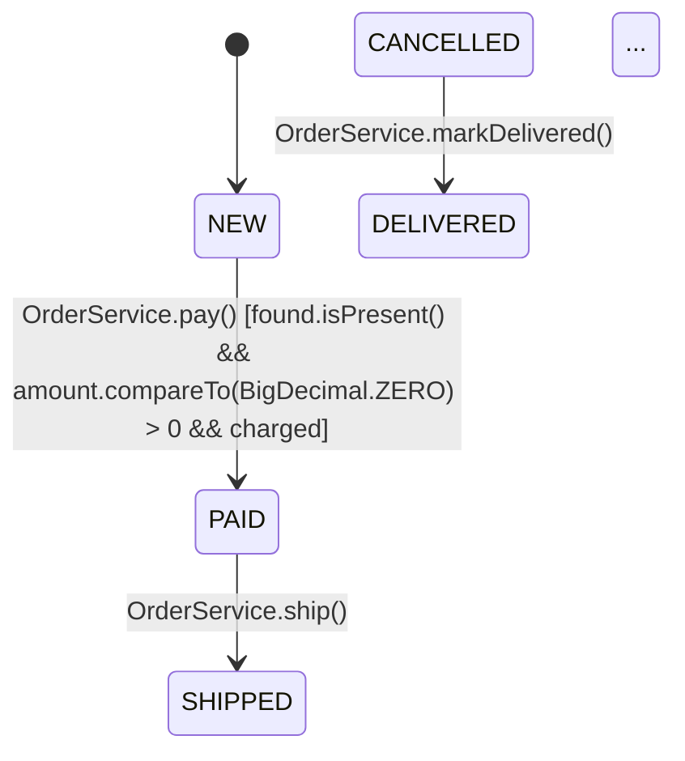

# truth-seeker

[](https://github.com/harrjdk/truth-seeker/actions/workflows/ci.yml)
[](LICENSE)

An MCP server that lets an LLM client (Claude Code, Claude Desktop, Codex, or a local model with MCP support)
**analyze compiled Java applications** — especially legacy Spring, Jakarta EE / Java EE and J2EE apps — and produce
**truth tables, state machine diagrams, call graphs and unit tests** straight from bytecode.

- Works on `.jar`, `.war`, `.ear`, Spring Boot fat jars and `target/classes` directories, including nested jars.
- **Never loads or runs the target application.** Classes are parsed with ASM; static initializers don't execute.
- No source code needed. Debug info (`-g`) improves names but isn't required.
- The server runs on **Java 17+**. It reads bytecode from Java 1.1 through 25, including javac and Eclipse (ECJ) output.

## Tools

| Tool | What it gives the model |
|---|---|
| `scan_archive` | Inventory: bytecode levels, bundled libraries, XML descriptors, stereotypes (Spring, EJB 2.x/3.x, Struts 1/2, servlets, JPA, MDBs, Quartz, Spring Batch…) and complexity hot spots |
| `list_endpoints` | HTTP routes (Spring MVC, JAX-RS, `@WebServlet`, **web.xml**, **struts-config.xml**), JMS/Kafka/Rabbit listeners, MDBs, `@Scheduled`, EJB timers, SOAP |
| `describe_class` | Kind, annotations, injected collaborators (field / constructor / setter (XML-wired) injection), fields, methods with cyclomatic complexity |
| `disassemble` | Raw bytecode for a class or one method, as ground truth |
| `call_graph` | Callers/callees as a Mermaid flowchart. Interface calls are expanded to the implementations in the archive |
| `truth_table` | A method's decisions and the **simplified boolean logic per outcome**. The summary (default) gives one row per outcome, with path counts and side effects listed once. `detail: "full"` gives one row per path, and `expand` adds the 2ⁿ table |
| `state_machine` | Mermaid / PlantUML state diagrams inferred from enum state. Also reports **derived state** (a status computed from other facts, e.g. from the last event). Flags unguarded transitions, never-entered or never-produced states, and state-guard rejections |
| `generate_unit_tests` | JUnit 5 + Mockito test classes (one class or `classNames`): one test per path, with solved inputs, stubs, assertions and `verify()` calls. Tests whose preconditions can't be arranged are `@Disabled` with exact `TODO`s. With `outputDir`, it writes the files and returns only a compact summary |
| `verify_tests` | Compiles test sources against the archive and runs them on JUnit 5 in a **separate JVM**. Reports passed / failed / disabled, with failures grouped by cause and disabled tests grouped by unresolved precondition. JUnit and Mockito are bundled, so it works offline. **Runs the application's code** |

All tools take `path`. The archive index is cached per path, so follow-up calls are fast.

Outputs are sized for an LLM's context: Markdown summaries by default, with full detail on request.
`format: "json"` (`truth_table`, `state_machine`), `generate_unit_tests` and `verify_tests` also return MCP `structuredContent`.
All tools except `generate_unit_tests` (writes files) and `verify_tests` (runs code) are annotated read-only, so clients can auto-approve them.

### The generate → verify loop

```text
generate_unit_tests  path=app.war  classNames=[...]  outputDir=build/gen-tests
verify_tests         path=app.war  testDir=build/gen-tests
```

`verify_tests` derives the classpath from the archive: Spring Boot `BOOT-INF/classes` + `BOOT-INF/lib`, WAR `WEB-INF/classes` + `WEB-INF/lib`, or EAR modules.
Files that don't compile are reported, and the rest still run.
If a `provided` API (`jakarta.*`, `javax.*`) is missing from the archive, pass it with `extraClasspath`.
It needs a JDK, not a JRE, and extracts to `java.io.tmpdir/truth-seeker` (override with `-Dtruthseeker.cache=…`).

### What it looks like

`truth_table` on a typical service method (`OrderService.pay`):

```
- C1: found.isPresent()
- C2: order.getStatus() != OrderStatus.NEW
- C3: amount.compareTo(BigDecimal.ZERO) <= 0
- C4: charged
where: found = this.orderRepository.findById(orderId), order = found.get(), charged = this.paymentGateway.charge(...)

|Path|C1|C2|C3|C4|Outcome                                  |Side effects                                         |
|P1  |F |- |- |- |throw IllegalArgumentException("No order…")|                                                  |
|P2  |T |T |- |- |throw IllegalStateException(…)           |                                                     |
|P3  |T |F |T |- |throw IllegalArgumentException("amount…") |                                                     |
|P4  |T |F |F |T |return charged                           |charge(…); order.setStatus(PAID); save(order); send(…)|
|P5  |T |F |F |F |return charged                           |charge(…)                                            |
```

`state_machine` over a whole archive, with an anemic entity whose transitions live in a service:


In this example the tool also reports: *⚠ Unguarded transitions: OrderService.markDelivered()* and *⚠ Never entered: ARCHIVED*.

Derived state, from [Eclipse Cargo Tracker](https://github.com/eclipse-ee4j/cargotracker)'s `Delivery`:

| TransportStatus | When |
|---|---|
| NOT_RECEIVED | `this.lastEvent == null` |
| ONBOARD_CARRIER | `this.lastEvent != null && this.lastEvent.getType() == Type.LOAD` |
| IN_PORT | `this.lastEvent != null && this.lastEvent.getType() in {Type.UNLOAD, Type.RECEIVE, Type.CUSTOMS}` |
| CLAIMED | `this.lastEvent != null && this.lastEvent.getType() == Type.CLAIM` |

The tool also notes that `UNKNOWN` is declared but never produced: its only path is the `default` of a switch that already covers every event type.

## Tested against real applications

The generated tests are compiled against each application and run with `verify_tests`, over MCP, on a Java 17 runtime.
A test whose preconditions can't all be arranged automatically is emitted as `@Disabled`, with `TODO`s saying exactly what to arrange.

| Application | Archive | Generated tests | Pass | Disabled (TODOs) | Fail |
|---|---|---|---|---|---|
| [Spring PetClinic](https://github.com/spring-projects/spring-petclinic) (Spring Boot 4.1) | 66 MB fat jar, 34k classes | 187 (12 classes) | 187 | 0 | 0 |
| [Eclipse Cargo Tracker](https://github.com/eclipse-ee4j/cargotracker) (Jakarta EE 10, Java 11 bytecode) | WAR, 112 app classes | 264 (18 classes) | 264 | 0 | 0 |

Every generated test arranges its path. Expected values are rebuilt from what the test controls (see below); 10
PetClinic and 12 Cargo Tracker tests still end with `assertNotNull(result)` (or no assertion) and a `TODO` naming the
expected expression, because the method builds the result itself (`new Delivery(..)`, a local `ModelAndView`), runs a
lambda over it, reads the clock, or formats through a library (`ToStringCreator`).

## Build

You need JDK 21+ to build (it compiles the Java 21 test fixtures), and Java 17+ to run.

```bash
./mvnw package
```

On Windows: `mvnw.cmd package`. This produces `target/truth-seeker.jar`, a single self-contained jar of about 18 MB. Most of that is the bundled JUnit/Mockito test kit used by `verify_tests`.
The wrapper uses `JAVA_HOME`, so point it at a JDK 21+ first if your default JDK is older.

The test suite also generates tests for the fixture classes, compiles them and runs them on the JUnit Platform.
So every build checks that `generate_unit_tests` output compiles and passes.

Each CI run also uploads the built jar as the `truth-seeker-jar` artifact.

## Connect a client

Use absolute paths below. The server speaks MCP over stdio.

**Claude Code**

```bash
claude mcp add truth-seeker -- java -jar /abs/path/to/truth-seeker.jar
```

**Claude Desktop** (`claude_desktop_config.json`), **Cursor**, and most other clients use the same shape:

```json
{
  "mcpServers": {
    "truth-seeker": {
      "command": "java",
      "args": ["-jar", "/abs/path/to/truth-seeker.jar"]
    }
  }
}
```

**Codex CLI** (`~/.codex/config.toml`):

```toml
[mcp_servers.truth-seeker]
command = "java"
args = ["-jar", "/abs/path/to/truth-seeker.jar"]
```

**Local models**: any MCP-capable host works with the same command/args, for example LM Studio, Continue,
Open WebUI via mcpo, or `ollmcp` for Ollama. Prefer a model with solid tool calling, since tool outputs are long Markdown.

If `java` on your PATH is older than 17, use the full path to a 17+ `java` executable as `command`.

### CLI mode (no MCP client needed)

```bash
java -jar target/truth-seeker.jar --cli truth_table path=app.war className=com.acme.PricingService method=quote expand=true
```

```bash
java -jar target/truth-seeker.jar --cli state_machine path=app.ear packagePrefix=com.acme format=plantuml
```

```bash
java -jar target/truth-seeker.jar --cli generate_unit_tests path=target/classes className=OrderService outputDir=src/test/java
```

## Suggested workflow for a legacy app

1. `scan_archive`: what is in it, what Java level it uses, and where the complexity is.
2. `list_endpoints`: how requests and messages enter the app.
3. `call_graph` from an endpoint: follow a request through controller → service → DAO.
4. `truth_table` on the business-rule methods it reaches: document the rules as they actually are.
5. `state_machine` on the domain enums: find illegal or unguarded transitions.
6. `generate_unit_tests` with `outputDir`, then `verify_tests`: pin the current behaviour with characterization tests that compile and pass before you refactor or migrate (e.g. javax → jakarta, Spring 4 → 6). Arrange the grouped TODOs it reports.

## How it works, and its limits

`truth_table`, `state_machine` and `generate_unit_tests` share a **bounded symbolic executor** (`symbolic/PathExplorer`).
It walks a method's bytecode, keeps every operand as a readable expression, forks at each branch and switch,
and prunes contradictory paths.

What it recognizes:
- local variable names from debug info
- enum switches (javac `$SwitchMap$`, ECJ `$SWITCH_TABLE$`, direct ordinal switches, Java 21 `enumSwitch`/`typeSwitch`)
- legacy `StringBuilder` and modern `indy` string concatenation
- boxing and unboxing
- pre-Java 5 `class$` literals
- `assert` statements
- logging guards (assumed off by default; `includeLogging=true` keeps them)
- calls on the class's own methods (`this.helper(..)`, private/static helpers, getters, `super.m(..)`), **inlined** up to 2 levels so their decisions join the caller's paths (`inlineSelfCalls=false` on `truth_table` for the method-local view)
- precondition helpers as branches to the exception they throw: `Objects.requireNonNull`, Spring `Assert`, Guava `Preconditions`, commons-lang `Validate`
- null checks on values the path already dereferenced (pruned as infeasible)
- **constructors of other application classes** (`new HandlingEvent(..)`), inlined so their validation (guards, `throw`s) becomes decisions on the arguments; their field writes stay inside
- calls on constant strings (`"".isEmpty()`) are computed, so impossible branches are dropped
- getters on a parameter (`pet.isNew()`) keep their value across loop iterations unless the path changes that parameter
- **rules held by enum constants**: a no-argument query on an application enum value (`type.requiresVoyage()`) is evaluated per constant from the enum's bytecode, and the path splits into groups such as `type in {LOAD, UNLOAD}`, which tests arrange by passing a matching constant
- **typed `catch` blocks**: a call inside `try` that can throw a caught type gets a path into the handler, as a `call throws X` decision (checked exceptions when the callee declares them; JDK calls only for specific types such as `NumberFormatException` around `Integer.parseInt`). `throw`s and failing guards inside `try` jump to their handler too, also across inlined helpers

What the test generator arranges:
- `for`-each loops over parameters, subject fields and stubbed collaborator results: a real collection with one mock element per iteration taken, each stubbed for its own iteration's decisions; `contains(x)` decides membership
- exception paths: `when(..).thenThrow(..)` / `doThrow(..).when(..)` on the collaborator, a mock exception when the handler inspects it (`ex.getMessage()`), and invalid/valid input for JDK parsers
- non-empty collections with a mock element of the type the code reads back (`(Leg) legs.get(0)`) or declares (`List<Leg> legs`), a `null` element when the path needs one, and emptiness through stream pipelines (`List.copyOf(events.stream().distinct().sorted(..).collect(toList()))` is empty when `events` is)
- `isEmpty()` and `iterator().next()` on mocked containers such as Spring Data's `Page`
- `Math.max`/`Math.min` bounds, and `isEmpty`/`contains`/`startsWith`/`endsWith` on strings through `strip()`/`trim()`/`toLowerCase()`
- `a.isAfter(b)` / `isBefore` between a field and a stubbed date, including one read through `toLocalDate()`
- expected values rebuilt in the test's own terms: the subject's fields are set to known values and stubbed results reused, so `"Voyage " + this.voyageNumber` becomes `assertEquals("Voyage " + voyageNumber, result)` and `Objects.hash(origin, destination)` is asserted with the same arguments; getters returning a constructor-injected collaborator assert it is the same `@Mock`
- `equals`-style comparisons with another instance of the subject's class (`Objects.equals(this.voyage, o.voyage)`): a second real instance, with equal or distinct field values set on both

These are deliberate approximations, and the tool output says so:
- `finally` and catch-all handlers are not entered; exceptions are only followed into typed `catch` blocks.
- Loops are unrolled `loopBound` times (default 1). Paths are capped by `maxPaths` (default 256).
- Bodies of *other* classes' methods are not explored (their constructors and enum queries are). Those calls stay symbolic, e.g. `this.repo.findById(id)`.
- State machines are inferred without inlining, so derived state (`calculateTransportStatus()`) stays distinct from transitions.
- State machines match state by holder type and property name (`Order.status`), not by object identity.
- Pre-Java 6 `JSR`/`RET` subroutines truncate the affected path.
- Generated tests characterize **current** behaviour. Review the `TODO`s and the expected values before trusting them as a spec.

## Project layout

```
src/main/java/dev/truthseeker/
  TruthSeekerServer.java   MCP stdio server + --cli runner
  Tools.java               tool catalogue: names, JSON schemas, handlers
  archive/                 JAR/WAR/EAR/dir indexing, name helpers
  symbolic/                Expr / Cond / Effect / Path model and the PathExplorer
  analysis/                inspector, endpoints, call graph, truth tables, simplifier, state machines
  testgen/                 JUnit 5 + Mockito generator
src/test/java/fixtures/    sample "legacy" code the tests analyze (anemic entity + service, rules, rich model)
src/test/java21/           Java 21 fixtures (pattern-matching switch), compiled on JDK 21+
```

## License

[MIT](LICENSE)
